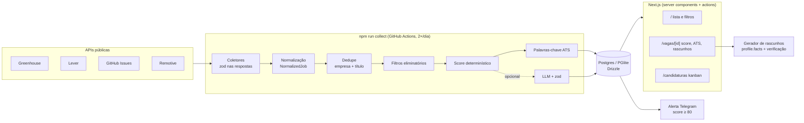

# Radar de Vagas

Painel pessoal que coleta vagas de tecnologia de APIs públicas, dá a cada uma um score de 0 a 100 **com explicação**, mostra quais palavras-chave de ATS faltam no currículo e prepara rascunhos de mensagem ao recrutador **sem inventar nada**. A candidatura continua manual.

> Projeto de uso pessoal, também mantido como portfólio. Stack: Next.js 16 (App Router), TypeScript estrito, Tailwind CSS 4, Drizzle ORM, PGlite/Postgres, zod, Vitest e Biome.

## O que ele faz

- **Coleta** vagas de Greenhouse, Lever, issues do GitHub (`frontendbr/vagas`, `react-brasil/vagas`, `backend-br/vagas`) e Remotive, duas vezes por dia.
- **Normaliza e deduplica**: a mesma vaga publicada no ATS da empresa e num repositório do GitHub vira um registro só, com as URLs extras guardadas.
- **Pontua de forma determinística** (stack, senioridade, modalidade, salário, recência) e aplica **filtros eliminatórios** (linguagem principal fora do perfil, sênior com 5+ anos, inglês fluente obrigatório, presencial fora das cidades aceitas, salário abaixo do piso). Cada ponto tem um motivo escrito.
- **Avaliação por LLM opcional** (Anthropic), com rubrica fixa e saída validada por zod, combinada ao score determinístico por média ponderada.
- **Palavras-chave de ATS** separadas em "você tem e não escreveu no CV" e "você não tem".
- **Rascunhos** (resumo do CV, mensagem de até 300 caracteres, resposta "fale sobre você") montados só com fatos de `config/profile.ts`, com uma verificação automática que reprova qualquer tecnologia, empresa ou número fora do perfil.
- **Acompanhamento**: status por vaga, notas, kanban de candidaturas com próximos passos e histórico de mudanças.
- **Alerta opcional no Telegram** para vagas novas com score ≥ 80.

## Por que não se candidata automaticamente

É uma regra de produto, não uma limitação técnica:

1. Os termos de uso do LinkedIn (e da maioria dos portais) proíbem automação, e o projeto não faz scraping de nenhuma página HTML: só usa APIs públicas documentadas.
2. Candidatura em massa produz aplicações genéricas, que recrutadores reconhecem e descartam. O valor está em escolher bem e personalizar, e é isso que o painel acelera.
3. Mensagens nunca são enviadas pelo sistema. Ele gera rascunhos, você revisa e envia.

## Arquitetura



Estrutura de pastas:

```
config/            perfil verificado, currículo, fontes e pesos do score
drizzle/           migrações SQL geradas pelo drizzle-kit
eval/              casos rotulados à mão para medir o score
scripts/           collect, eval, migrate e seed (executados com tsx)
src/app/           páginas e server actions do painel
src/collectors/    um arquivo por fonte + heurísticas de extração
src/db/            schema, cliente (PGlite ou Postgres) e repositórios
src/domain/        tipos de domínio, catálogo de tecnologias, filtros da URL
src/eval/          métricas, relatório e gates do eval
src/drafts/        templates, gerador com LLM e verificação anti-invenção
src/pipeline/      orquestração da coleta, dedupe e alertas
src/scoring/       filtros, componentes do score, LLM e palavras-chave
test/              testes unitários e de integração, fixtures das APIs
```

## Como rodar localmente

Requisitos: Node 22.12+ e npm. Não é preciso instalar Postgres: em desenvolvimento o banco é o [PGlite](https://pglite.dev) (Postgres compilado para WASM) gravado em `.data/pglite`.

```bash
npm install
cp .env.example .env      # opcional: tudo funciona sem preencher nada
npm run db:seed           # opcional: carrega as vagas de exemplo das fixtures
npm run dev               # http://localhost:3000
```

Para buscar vagas reais:

```bash
npm run collect
```

> Com PGlite, o banco em disco só pode ser aberto por um processo de cada vez. Pare o `npm run dev` antes de rodar `collect` ou `db:seed`, ou use um Postgres local em `DATABASE_URL`.

Outros comandos:

| Comando               | O que faz                                            |
| --------------------- | ---------------------------------------------------- |
| `npm test`            | Vitest, 100% offline (fixtures + PGlite em memória)  |
| `npm run eval`        | Mede o score contra os casos rotulados de `eval/`    |
| `npm run typecheck`   | Gera os tipos de rota do Next e roda `tsc --noEmit`  |
| `npm run lint`        | Biome (lint + formatação)                            |
| `npm run build`       | Build de produção                                    |
| `npm run db:generate` | Gera uma nova migração após mudar `src/db/schema.ts` |
| `npm run db:migrate`  | Aplica as migrações no banco configurado             |

## Variáveis de ambiente

Nenhuma é obrigatória para rodar localmente. Veja `.env.example`.

| Variável                                 | Para que serve                                                                |
| ---------------------------------------- | ----------------------------------------------------------------------------- |
| `DATABASE_URL`                           | Postgres de produção (ex.: Supabase). Vazio = PGlite em `PGLITE_DATA_DIR`.    |
| `PGLITE_DATA_DIR`                        | Diretório do PGlite local (padrão `.data/pglite`).                            |
| `ANTHROPIC_API_KEY`                      | Liga a avaliação por LLM e o botão "Gerar com IA".                            |
| `ANTHROPIC_MODEL`                        | Modelo usado (padrão `claude-sonnet-5-5`).                                    |
| `LLM_WEIGHT`                             | Peso do LLM na média com o determinístico, de 0 a 1 (padrão 0,3).             |
| `SALARY_FLOOR_BRL`                       | Piso salarial mensal em reais. Sem valor, o filtro de salário fica desligado. |
| `TELEGRAM_BOT_TOKEN`, `TELEGRAM_CHAT_ID` | Alerta de vagas novas com score ≥ 80.                                         |
| `GITHUB_TOKEN`                           | Opcional; aumenta o limite da API do GitHub. No Actions já vem injetado.      |
| `DASHBOARD_PASSWORD`                     | Protege o painel com Basic Auth (`src/proxy.ts`). Obrigatória na Vercel.      |

No GitHub, configure `DATABASE_URL`, `ANTHROPIC_API_KEY`, `TELEGRAM_BOT_TOKEN` e `TELEGRAM_CHAT_ID` como **secrets**, e `SALARY_FLOOR_BRL`, `LLM_WEIGHT` e `ANTHROPIC_MODEL` como **variables** do repositório.

## Como o score funciona

1. **Filtros eliminatórios** zeram o score e registram o motivo. Eles só olham o título e as linhas de **requisito**: a descrição é dividida em seções (requisitos, diferenciais, benefícios), então ".NET como diferencial" não derruba uma vaga de React, e "Node.js ou Java" também não.
2. **Componentes determinísticos** (soma = 100): stack 40 (React 10, Next.js 8, TypeScript 8, Node/NestJS 5, Tailwind 3, Testes 3, AWS 3), senioridade 20, modalidade 20, salário 10, recência 10. Os pesos ficam em `config/scoring.ts`.
3. **LLM opcional**: nota 0–100 por rubrica fixa, validada por zod; o final é `determinístico × (1 − peso) + LLM × peso`. Vagas eliminadas não gastam chamada. Se o LLM falhar, o score determinístico continua valendo e o erro aparece no painel.
4. Tudo fica em `jobs.score_breakdown` (jsonb), que o painel mostra componente a componente.

O score é calculado na primeira vez que a vaga aparece; coletas seguintes só atualizam `last_seen_at` e as URLs extras.

## Eval do score

O score é medido contra **30 casos rotulados à mão** (`eval/cases.ts`), cada um cobrindo uma armadilha da heurística: ".NET como diferencial", "Node.js ou Java", "Golang", inglês fluente só como diferencial, salário em dólar, Java citado só na seção "sobre a empresa" etc. O rótulo é o julgamento humano a partir do perfil, nunca o que o score calcula; se os dois discordam, a divergência é um achado.

`npm run eval` mede, sem LLM (reprodutível e offline):

- **Eliminações**: precisão e recall por regra (linguagem, senioridade, inglês, presencial, salário).
- **Relevância**: uma vaga conta como relevante quando o score é ≥ `scoring.evaluation.relevantMinScore` (60).

Resultado atual:

| Métrica                    | Precisão | Recall | F1    |
| -------------------------- | -------- | ------ | ----- |
| Eliminações (14 esperadas) | 100%     | 100%   | 100%  |
| Relevância (score ≥ 60)    | 86,7%    | 100%   | 92,9% |

Divergências conhecidas (falsos positivos de relevância):

- **Híbrido fora das cidades aceitas** (`hibrido-curitiba`, score 64): a modalidade zera, mas o resto do score passa de 60. O SPEC não tem filtro eliminatório para esse caso.
- **Stack fora do perfil sem ser linguagem proibida** (`vue-front`, score 63): Vue não está no perfil, mas TypeScript, senioridade e modalidade bastam para passar de 60.

O CI roda o eval e reprova se a precisão ou o recall das eliminações ficarem abaixo de 90% ou o F1 de relevância abaixo de 80% (`scripts/eval.ts`). Os mínimos só sobem.

## Rascunhos sem invenção

- Os fatos estão em `config/profile.ts`, em primeira pessoa. As tecnologias que um fato autoriza citar são as que o catálogo (`src/domain/tech-catalog.ts`) reconhece no próprio texto, então lista e texto nunca divergem.
- Sem LLM, os rascunhos são templates que reaproveitam os fatos mais relevantes para a vaga.
- Com LLM, o prompt proíbe acrescentar fatos e cada rascunho passa por `verifyDraft`, que reprova tecnologia fora do perfil, número que não está nos fatos e nome próprio desconhecido (empresa, produto). O reprovado é trocado pelo template, e o painel mostra o que foi barrado.
- Citar o título e a empresa **da vaga** é permitido: não é afirmar experiência.
- `config/resume.ts` deve conter o texto do seu currículo atual; é com ele que as palavras-chave são comparadas.

## Como adicionar uma empresa ou fonte

**Nova empresa em Greenhouse ou Lever**: acrescente em `config/sources.ts`.

- Greenhouse: o token é o trecho depois de `boards.greenhouse.io/` (ou `job-boards.greenhouse.io/`) na página de vagas.
- Lever: o slug é o trecho depois de `jobs.lever.co/`.

**Nova fonte (outra API pública)**:

1. Crie `src/collectors/<fonte>.ts` com um schema zod da resposta, uma função `normalize…` que devolve `NormalizedJob` e uma fábrica que implementa `Collector<RawJob>` usando o `fetch` injetado.
2. Acrescente o id em `SOURCES` (`src/domain/job.ts`), a prioridade em `dedupe.ts` e a configuração em `config/sources.ts`.
3. Registre a fábrica em `src/collectors/index.ts`.
4. Grave uma fixture realista em `test/fixtures/`, mapeie a URL em `test/support/fixtures.ts` e escreva o teste de normalização.

Só APIs públicas documentadas: scraping de HTML está fora do escopo de propósito.

## Deploy

1. Crie um projeto no Supabase e copie a connection string do pooler para o secret `DATABASE_URL`.
2. O workflow `.github/workflows/collect.yml` roda `npm run collect` às 08:00 e 18:00 (horário de Brasília). Ele aplica as migrações antes de coletar. Também pode ser disparado manualmente em _Actions → Coleta de vagas → Run workflow_.
3. O painel pode rodar localmente apontando para o mesmo `DATABASE_URL`, ou ser publicado na Vercel (abaixo).

### Painel na Vercel

1. Em [vercel.com/new](https://vercel.com/new), importe o repositório. O preset Next.js já serve: build `npm run build`, sem mudar nada.
2. Em _Settings → Environment Variables_, cadastre para Production (e Preview, se for usar):
   - `DATABASE_URL`: a connection string do **pooler de transações** do Supabase (porta `6543`), a mesma do secret do Actions.
   - `DASHBOARD_PASSWORD`: a senha do painel. O navegador pede usuário e senha; qualquer usuário serve.
   - Opcionais: `ANTHROPIC_API_KEY`, `ANTHROPIC_MODEL`, `LLM_WEIGHT`, `SALARY_FLOOR_BRL`.
3. Faça o deploy. As migrações **não** rodam na Vercel: quem as aplica é o workflow de coleta (ou `npm run db:migrate` local apontando para o Supabase).

Salvaguardas no código:

- Com `VERCEL=1` (definido pela própria Vercel), faltar `DATABASE_URL` ou `DASHBOARD_PASSWORD` é erro: o painel não sobe aberto nem cai no PGlite, que gravaria num disco efêmero.
- O `src/proxy.ts` responde 503 se, mesmo assim, chegar uma requisição sem senha configurada.
- Na Vercel, cada função abre no máximo uma conexão com o Postgres, para não esgotar o pooler do Supabase.

## Decisões técnicas

- **Drizzle + PGlite em vez de Prisma**: o mesmo schema e as mesmas migrações SQL rodam no PGlite (dev e testes, sem servidor e sem download de engines) e no Postgres de produção. Os repositórios recebem o tipo comum `PgDatabase` e não sabem qual driver está por trás.
- **`fetch` injetável em todos os coletores**: os testes usam fixtures que reproduzem o formato real de cada API, e nenhuma linha de teste acessa a rede.
- **zod em todas as fronteiras**: respostas das APIs (item a item, para um registro quebrado não derrubar a fonte), saída do LLM, variáveis de ambiente, query string e formulários das server actions.
- **Falhas isoladas**: uma fonte fora do ar, um LLM lento ou um Telegram indisponível nunca impedem o resto da coleta de ser gravado.
- **Coluna `modality`** ao lado de `remote`: o booleano não distingue híbrido de presencial, e o score precisa dessa diferença. `remote` é derivado dela.
- **Server components e server actions**: os formulários (status, notas, candidatura) funcionam sem JavaScript no cliente; o único componente cliente relevante é o painel de rascunhos (copiar e gerar com IA).
- **`proxy.ts`** é o nome do antigo `middleware.ts` no Next.js 16.
- **Sem fontes remotas**: pilha de fontes do sistema, para o build funcionar offline.

## Limitações conhecidas

- As heurísticas de extração (senioridade, modalidade, salário, seções da descrição) são baseadas em padrões de texto e podem errar em descrições muito fora do padrão. O breakdown sempre mostra o motivo, para facilitar a correção.
- A verificação de nomes próprios não detecta empresa escrita em minúsculas nem na primeira palavra da frase; tecnologias e números são verificados em qualquer posição.
- Salários em dólar não são convertidos: o filtro de piso só vale para BRL.
- Com PGlite, apenas um processo pode abrir o banco em disco por vez.
